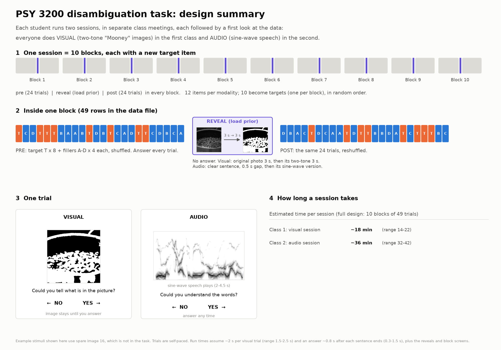

# Mooney Prediction Task (PSY 3200, The Predictive Brain)

## What the experiment tests

Some images and sounds are so degraded that you cannot tell what they are: a
black-and-white "two-tone" photo, or "sine-wave speech" made of three whistles.
Once you have seen the original photo or heard the clear sentence, the same
degraded version suddenly makes sense.

Predictive-processing theories say this happens because the brain uses what it
already knows (a *prior*) to interpret ambiguous input. In each block of this
experiment you rate the degraded items, then see or hear the clear original of
**one** of them (the *target*), the **reveal (load prior)**, then rate them all
again. If the prior explains recognition, the target should improve much more
than the other items, whose originals you have not seen.



**Do not open the `stimuli/` folders before you run the task.** Seeing the
originals in advance ruins the effect for you.

## Before the first class (once, about 10 minutes)

1. **GitHub account.** Make one at [github.com](https://github.com) if you do
   not have one, and send your GitHub username to your instructor, who adds you
   to this repository so your data can be uploaded.
2. **Python 3.12** from [python.org](https://www.python.org/downloads/).
   Windows: in the installer, tick **Add python.exe to PATH**.
3. **GitHub CLI** from [cli.github.com](https://cli.github.com) (Mac: the
   `.pkg` download; Windows: the `.msi` download).
4. **This task:** on this page, click the green **Code → Download ZIP**, and
   unzip it into your Documents folder. (Or `git clone
   https://github.com/BastosLab/PSY3200-PredictiveBrain.git`.)
5. **Open a terminal in that folder.** Mac: right-click the folder → **Services →
   New Terminal at Folder**. Windows: click the folder's address bar, type `cmd`,
   press Enter. Then run:

   ```bash
   python3 setup_student.py
   ```

   (On Windows, type `py` instead of `python3`, here and below.)

   This installs the Python packages, checks pictures and sound, signs you in to
   GitHub in your browser, accepts your invitation to this repository, asks
   your name, and uploads a small check-in file. It ends with **All set**.
   If it stops, it says why; fix that and run it again.

### Or: let Claude Code set you up

If you have [Claude Code](https://claude.com/claude-code) (the **Code** tab in
the Claude desktop app, or the `claude` command in a terminal), it can do
steps 2–5 for you. Do step 1 yourself (send your GitHub username), open Claude
Code in your Documents folder, and paste:

> Set me up for PSY 3200: get https://github.com/BastosLab/PSY3200-PredictiveBrain
> into this folder and follow the setup instructions in its CLAUDE.md.

Claude asks before installing anything. You still type your own password if
an installer needs it, and you sign in to GitHub in your browser yourself.
The ordinary Claude chat cannot run programs on your computer, so this needs
Claude Code.

In class, you can also ask Claude Code (opened in the task folder) to
**"start my visual session"** (or audio). It starts the task with your saved
name; you answer the trials yourself. Your data are saved in `my_data/` as you
go and uploaded to GitHub at the end, and Claude checks the upload afterwards
(**"upload my data"** does just that step).

## In class

Everyone does the **visual** session in the first class and the **audio**
session in the second (bring headphones). Open a terminal in the task folder
(as in step 5) and run:

```bash
python3 mooney_prediction_task_blocks.py
```

Choose VISUAL or AUDIO, check that your name is right, and click Start. Each
block starts on a break screen showing its number ("Block 3 of 10"): take a
break if you need one, then press SPACE to start the block.
Keys: **→ = yes**, **← = no**, **SPACE** to start each block, **ESC** to quit (it asks first).

| Session (10 blocks of 49 trials) | Approx. time |
|---|---|
| Visual | 18 min (14-22) |
| Audio | 36 min (32-42) |

Trials are self-paced: the next one starts as soon as you answer. A visual trial
takes about 2 s. An audio trial lasts the whole sentence (2-4.5 s, 3.5 s on
average) plus your answer, which is why the audio session is twice as long.

**At the end, the program uploads your data to GitHub by itself.** Wait until
the last screen says *Uploaded to GitHub* before you close the window.

## Your data

- **On your computer:** in the `my_data` folder inside the task folder, named
  `Visual_Mooney_Experiment_<YourName>_<date>_<time>.csv`, for example
  `Visual_Mooney_Experiment_JaneDoe_2026-11-10_14-05-31.csv` (audio:
  `Audio_SineWaveSpeech_Experiment_...`). Each trial is saved the moment it
  ends, so nothing is lost if the window closes or the computer crashes.
- **On GitHub:** on this repository's
  [`class-data` branch](https://github.com/BastosLab/PSY3200-PredictiveBrain/tree/class-data/class_data),
  in `class_data/visual/` or `class_data/audio/`, uploaded under your GitHub
  account. This repository is public, so anyone can see the file, which has
  your name in it.
- **Upload failed** (for example, no internet)? Your file is safe. Run this
  later; it uploads anything that is not on GitHub yet:

  ```bash
  python3 upload_data.py
  ```

Columns: `participant_id` (your name), `modality, seed, n_blocks, block, trial_number,
trial_type` (pre / reveal / post), `target_index, stimulus_index` (1-12),
`stimulus_file, condition` (target / filler_new / filler_old), `response`
(yes / no), `recognized` (1 / 0), `reaction_time_ms, timestamp`. The
reveal (load prior) row has `NA` for the response columns.

## Analyse (after each class)

Your own session:

```bash
python3 analysis/analyze_session.py my_data/Visual_Mooney_Experiment_JaneDoe_2026-11-10_14-05-31.csv
```

The whole class (this first downloads everyone's latest data from GitHub into
`class_data/`):

```bash
python3 analysis/analyze_class.py --download
```

After the first class this tests the visual effect. After the second class it
also tests the audio effect and compares audio with visual within each student.
Because everyone did visual first, that comparison also includes any effect of
doing the task a second time (for example, already knowing that a reveal is coming).

Results go to `results/`. To see what the class analysis produces before any
real data exist:

```bash
python3 analysis/simulate_class_data.py
python3 analysis/analyze_class.py data/simulated/
```

## Problems

- **Mac, "No module named tkinter"** (Homebrew Python): install Python from
  python.org instead, or run `brew install python-tk`.
- **pygame:** `requirements.txt` installs `pygame-ce`, which provides
  `import pygame` on every recent Python. If the older `pygame` package is also
  installed, uninstall it.
- **"gh: command not found"** right after installing the GitHub CLI: close the
  terminal and open a new one.
- **"externally-managed-environment"** when packages install: that Python
  (usually Homebrew's) does not allow it. Install Python from python.org and use that.

## Found a bug? Propose a fix

Anyone can propose a change; André or Ishan must approve changes to the code
before they go in (your data uploads go to the `class-data` branch and need no
approval). Make the change on a new
branch (or in a fork, if you are not in the class), check that
`python3 -m pytest tests/` still passes, and open a pull request saying what was
wrong and how you checked the fix.

## For instructors

- **Adding students:** collect GitHub usernames, then
  `python3 tools/invite_students.py usernames.txt` (one per line) gives each
  write access to this repository. `python3 tools/invite_students.py --status`
  lists who has finished setup (their check-in file in `class_data/checkins/` on
  the `class-data` branch) and who has not accepted yet.
- **Who can change what:** `main` (the task) accepts changes only through pull
  requests approved by a code owner (`.github/CODEOWNERS`: André, Ishan), who
  can also push to it directly. The `class-data` branch (the data) takes the
  students' uploads directly. Neither branch can be force-pushed or deleted.
- **Test runs:** a shortened run such as
  `python3 mooney_prediction_task_blocks.py --blocks 2` uploads to
  `class_data/demo/` on the `class-data` branch, which the class analysis skips. Add `--no-upload` to keep
  it on your computer only. `--autopilot` runs are never uploaded.
- Uploads use each student's own GitHub CLI login (`class_repo.py`), so every
  file is credited to the student's account. Concurrent uploads retry.
- `make_stimuli.py` rebuilds the two-tone images and sine-wave speech from
  `stimuli/images/*.jpg` and `stimuli/sounds/*.mp3` (needs `praat-parselmouth`
  and `soundfile`). Per-image difficulty settings are at its top.
- `docs/make_design_figure.py` redraws the design figure and prints run-time estimates.
- `--blocks`, `--target-reps` and `--filler-reps` shorten a session (for demos;
  the class uses the full design).
- `python3 -m pytest tests/` runs the tests: autopilot sessions in both
  modalities, crash safety, sequence checks, uploads against a fake GitHub, and
  the analysis on simulated data.
- `CHANGES.md` lists what was fixed and why.

PSY 3200 Predictive Brain | Vanderbilt University | Prof. André Bastos
