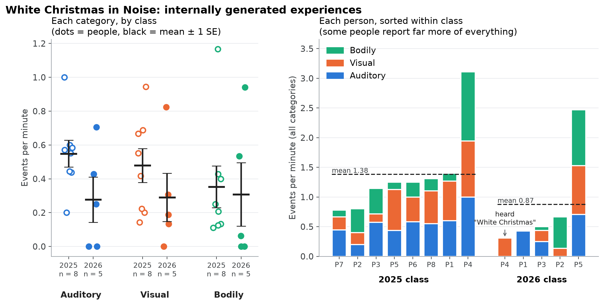

# White Christmas in Noise

Participants sit in white noise for about 15 minutes and say out loud every sound, image
or bodily feeling they notice. The experimenter writes down the time and the type:

| Code | Type | Examples |
|---|---|---|
| 1 | Auditory | voices, music, sounds inside the noise |
| 2 | Visual | images, shapes, colours |
| 3 | Bodily | touches, tingling, temperature |

At the end, the experimenter asks: did you hear "White Christmas"? Did you fall asleep?

## Files

- `sessions.csv`: one row per participant: class year, label, session length in minutes,
  and either the counts (2025) or the spreadsheet they come from (2026).
- `spreadsheets/2026/`: the 2026 class's recording sheets, renamed P1 to P5 with names removed.
- `analyze_white_christmas.py`: counts the events, converts them to events per minute,
  and draws `white_christmas_results.png`.

## Run it

```bash
python3 white-christmas-analysis/analyze_white_christmas.py
```

It prints the mean ± SE for each category and class, and saves the figure.

## Results so far



| Events per minute (mean ± SE) | 2025 (n = 8) | 2026 (n = 5) |
|---|---|---|
| Auditory | 0.55 ± 0.08 | 0.28 ± 0.13 |
| Visual | 0.48 ± 0.10 | 0.29 ± 0.14 |
| Bodily | 0.35 ± 0.12 | 0.31 ± 0.19 |
| All types | 1.38 ± 0.26 | 0.87 ± 0.40 |

One 2026 participant reported hearing "White Christmas" (the chorus).

People differ a lot: in both classes one person reported about three times as many events
as the class mean, across all three types.

## Caveats

- The 2025 counts come from Ishan's tally; the 2025 spreadsheets are not here.
- Session lengths are estimates, so events per minute are approximate.
- `P4.xlsx` has a second Time / Type / Code block (two events, its own
  "White Christmas? No"). It is not counted; see the note in `sessions.csv`.

Original analysis by Ishan Mahajan
([white-christmas-analysis](https://github.com/ishanmahajan73-gif/white-christmas-analysis)).
